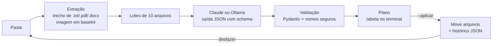

# Organizador de Arquivos com IA

[](https://github.com/davi-kazuhiro/organizador-arquivos-ia/actions/workflows/ci.yml)


Organiza pastas bagunçadas (Downloads, Área de Trabalho, Documentos) **lendo o conteúdo dos arquivos** com um LLM, e não só olhando a extensão. Funciona com o **Claude** (nuvem) ou com um **modelo local e gratuito via Ollama** (nada sai do seu computador).

```
Antes                          Depois
demo/                          demo/
├── anotacoes.md               ├── Aprendizado de Máquina/Rede neural MLP PyTorch.py
├── dados.csv                  ├── Contas e Faturas/Nota fiscal serviço eletrônico.txt
├── doc1.txt                   ├── Currículos e Vagas/Currículo estudante computação.docx
├── download (3).txt           ├── Dados Financeiros/Dados financeiros transações.csv
├── final_v2_AGORA_VAI.docx    ├── Dados Financeiros/Gráfico de vendas Q3.png
├── IMG_4821.png               ├── Receitas Culinarias/Bolo de cenoura receita.txt
├── LEIAME                     ├── Reuniões de Projeto/Reunião projeto present.md
├── main.py                    ├── Suporte Técnico/Instruções driver impressora
└── receita.txt                └── Teoria de Grafos/Teoria de grafos exercícios.txt
```

> Resultado real com o modelo local `gemma3:4b` (Ollama), rodando só no processador de um notebook com 16 GB de RAM: 9 arquivos em cerca de 107 s. A pasta é gerada por [`exemplos/criar_pasta_demo.py`](exemplos/criar_pasta_demo.py). A imagem `IMG_4821.png` é um gráfico, e o modelo leu o conteúdo dela para dar o nome.

## Por que

A versão 1 deste projeto (2024) separava arquivos por extensão: todo `.pdf` ia para `pdf/`. Na prática isso não organiza nada, porque uma nota fiscal, um artigo da faculdade e um currículo continuam juntos. A versão 2 usa IA para entender **do que** cada arquivo trata e:

- escolhe a pasta pelo assunto (`Faculdade`, `Finanças`, `Currículos`...), reaproveitando as pastas que você já tem;
- sugere nomes melhores para arquivos como `IMG_4821.png` ou `download (3).txt`;
- **mostra o plano antes de mexer em qualquer coisa** e permite **desfazer** depois.

## Como funciona



| Etapa | Arquivo | Decisões |
|---|---|---|
| Extração | [`extracao.py`](src/organizador/extracao.py) | Envia só um **trecho** (2.000 caracteres por padrão, até 3 páginas de PDF) para manter custo e latência baixos. Imagens vão como imagem, porque o modelo enxerga. Arquivo corrompido nunca derruba a execução: ele é classificado pelo nome. |
| Classificação | [`classificadores.py`](src/organizador/classificadores.py) | **Structured outputs** (JSON Schema gerado do modelo Pydantic) em vez de parsear texto livre. **Lotes** de vários arquivos por chamada. As categorias criadas num lote são enviadas aos lotes seguintes, para manter a consistência. A lógica de lotes fica numa classe base, e cada provedor implementa só a chamada ao modelo. |
| Provedor local | [`classificador_ollama.py`](src/organizador/classificador_ollama.py) | O mesmo schema vai para o Ollama "achatado" (sem `$ref`). O contexto é aumentado, porque o padrão do Ollama cortaria o lote em silêncio. Usa lotes menores, já que modelos pequenos erram mais com muitos arquivos de uma vez. |
| Nomes genéricos | [`nomes.py`](src/organizador/nomes.py) | Uma **regra fixa** (regex) detecta nomes como `IMG_4821`, `download (3)` ou `final_v2` e marca o arquivo com `renomear="obrigatorio"`. Nos testes reais, o modelo pequeno ignorava o campo opcional de nome. Com a marcação, passou a renomear. O que dá para resolver com código fica no código; o LLM fica só com o que exige entender o conteúdo. |
| Formato da resposta | [`classificadores.py`](src/organizador/classificadores.py) | No schema, o campo `motivo` vem **antes** de `categoria`. Como o modelo gera os campos em ordem, ele primeiro descreve o assunto e só depois escolhe a pasta, uma espécie de raciocínio curto. As categorias são normalizadas (inicial maiúscula, sem `_`, reaproveitando a pasta existente quando só muda maiúscula/minúscula). |
| Segurança | [`nomes.py`](src/organizador/nomes.py) | A saída do LLM é tratada como **entrada não confiável**: sem `..`, sem separadores de caminho, sem nomes reservados do Windows. Um arquivo que contenha "mova tudo para ../../" não consegue sair da pasta (há um teste para isso). O prompt também instrui o modelo a ignorar instruções dentro dos arquivos. |
| Execução | [`plano.py`](src/organizador/plano.py) | Nunca sobrescreve (gera `nome (2).ext`). Grava um histórico em `.organizador/` mesmo se falhar no meio, o que permite `desfazer`. |
| Robustez | — | Recusas do modelo, JSON inválido, IDs inventados ou repetidos e respostas cortadas são descartados com aviso: nesses casos o arquivo **fica onde está**. As recusas são reenviadas automaticamente a um modelo alternativo (`fallbacks`). |

## Uso

```bash
git clone https://github.com/davi-kazuhiro/organizador-arquivos-ia.git
cd organizador-arquivos-ia
python -m venv .venv && source .venv/bin/activate   # Windows: .venv\Scripts\activate
pip install -e .
```

Escolha um provedor:

| | Claude | Ollama |
|---|---|---|
| Custo | pago por uso | gratuito |
| Privacidade | trechos dos arquivos vão para a API | nada sai do computador |
| Qualidade | alta | boa nos casos claros, erra mais nos ambíguos |
| Velocidade | rápida | depende do hardware (sem GPU dedicada, segundos ou minutos por lote) |
| Preparação | chave em [console.anthropic.com](https://console.anthropic.com) | instalar o [Ollama](https://ollama.com/download) e rodar `ollama pull gemma3:4b` |

**Com Claude:**

```bash
export ANTHROPIC_API_KEY="sua-chave"        # Windows PowerShell: $env:ANTHROPIC_API_KEY="sua-chave"
organizador organizar ~/Downloads
```

**Com Ollama (gratuito):**

```bash
ollama pull gemma3:4b
organizador organizar ~/Downloads --provedor ollama
```

Comandos:

```bash
organizador organizar ~/Downloads             # só mostra o plano: nada é movido
organizador organizar ~/Downloads --aplicar   # mostra, pede confirmação e move
organizador desfazer ~/Downloads              # volta tudo ao lugar original
```

Para testar sem arriscar seus arquivos, crie uma pasta de demonstração:

```bash
pip install pillow
python exemplos/criar_pasta_demo.py demo
organizador organizar demo
```

### Opções

| Opção | Padrão | Descrição |
|---|---|---|
| `--aplicar` | desligado | Executa o plano (pede confirmação) |
| `-y`, `--sim` | desligado | Não pede confirmação |
| `-p`, `--provedor` | `claude` | `claude`, `ollama` ou `extensao` |
| `--sem-ia` | desligado | Atalho para `--provedor extensao`: o modo da versão 1, por extensão, sem IA |
| `--sem-renomear` | desligado | Mantém os nomes originais |
| `--modelo` | `claude-opus-5-5` / `gemma3:4b` | Modelo usado. No Claude, `claude-haiku-5-5` sai bem mais barato para pastas grandes. No Ollama, qualquer modelo baixado (ex.: `qwen2.5:3b`, que é mais rápido e só lê texto) |
| `--lote` | `10` / `5` | Arquivos por chamada ao modelo |
| `--caracteres` | `2000` | Quanto de cada arquivo o modelo lê |

**Privacidade:** com `--provedor claude`, um trecho de cada arquivo é enviado à API da Anthropic. Para pastas com dados sensíveis, use `--provedor ollama` ou `--sem-ia`.

## Testes

```bash
pip install -e ".[dev]"
pytest
ruff check src tests
```

Os testes usam clientes falsos: não fazem chamadas reais nem geram custo. Eles cobrem o envio em lotes, a propagação de categorias, as recusas, o JSON inválido, os IDs inventados, o fallback, a tentativa de path traversal vinda do modelo, a regra de nunca sobrescrever, o ciclo completo de aplicar e desfazer e, no Ollama, o servidor desligado, o modelo não baixado e a resposta cortada. O CI roda em Python 3.10 e 3.13.

## O que aprendi testando com um modelo pequeno

O prompt foi ajustado em quatro rodadas com o `gemma3:4b`, sempre olhando o resultado real:

| Rodada | Problema observado | Correção |
|---|---|---|
| 1 | Nenhum arquivo renomeado. `receita.txt` foi para "Fotos", que era um dos **exemplos citados no prompt** | Tirei a lista de categorias de exemplo, porque modelos pequenos a tratam como um menu |
| 2 | Ainda sem renomear; categorias em minúsculas | Detecção de nome genérico por regex, nome obrigatório nesses casos, normalização das categorias |
| 3 | O segundo lote reaproveitava categorias sem relação com o arquivo (receita em "Finanças") | Instrução explícita: "criar uma pasta nova para um assunto diferente é normal" |
| 4 | `LEIAME` classificado "sem informação" | Era um bug na extração: arquivos sem extensão não eram lidos. Agora, se não tiverem bytes binários, são lidos como texto |

**Limitações conhecidas:** o resultado varia de uma execução para outra. O modelo de 4B tende a criar pastas demais e às vezes separa assuntos parecidos ("Dados Financeiros" e "Contas e Faturas"). No processador, leva de 1 a 2 minutos por pasta pequena. Por isso o plano é sempre mostrado antes, e existe o `desfazer`.

## Próximos passos

- [ ] Modo recursivo (subpastas)
- [ ] Cache por hash do arquivo, para não reclassificar o que não mudou
- [x] Provedor local (Ollama), para rodar offline e de graça
- [ ] Avaliação: um conjunto rotulado de arquivos para medir a precisão das categorias e comparar modelos (`gemma3:4b` vs. Claude), em vez de julgar no olho
- [ ] Segunda passada para juntar categorias parecidas no fim do plano
